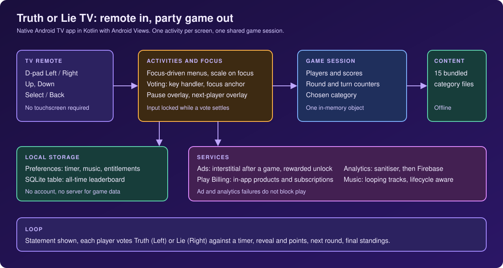
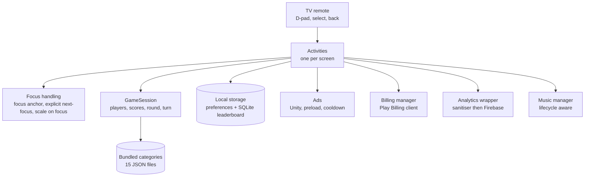

# Truth or Lie TV

**A party game for Android TV: a statement appears on the big screen, each player takes a turn voting Truth or Lie with the remote's D-pad before a timer runs out, and the TV reveals the answer and keeps the score.**

**Android TV** 
Kotlin · Android Views · Play Billing · Unity Ads · Firebase Analytics · D-pad focus and input engineering

<b>TV launcher artwork</b>: the banner shown on the Android TV home screen. Product artwork, not a screenshot.

---

## Get the App

  

The Play listing is titled "Truth or Lie TV: Party Game". The app declares the Leanback feature as required and does not require a touchscreen.

## Product at a Glance

| | |
|---|---|
| **What it is** | A hot-seat quiz for a living-room TV: the same statement is shown to everyone, each player votes in turn, and the TV reveals whether it was true |
| **Platform** | Android TV only (Leanback required, TV banner, no touchscreen requirement) |
| **Input** | Remote D-pad, Select and Back. Left votes Truth, Right votes Lie, Select locks the vote, Up or Back pauses |
| **Players** | 1 to 6 in the reviewed build, with optional names (3 to 10 characters). The launcher banner artwork shows a different range |
| **Rounds** | 3, 5, 7, 10 or 15 rounds. One statement per round, one vote per player |
| **Vote timer** | 10 to 50 seconds in 10-second steps, 20 seconds by default |
| **Scoring** | 100 points for each correct vote. No time bonus or streak bonus |
| **Content** | 15 bundled categories and about 3,550 statements, each marked true or false. 3 categories are free and 12 are paid or unlockable |
| **Monetisation** | Unity Ads (an interstitial after a game, a rewarded ad to unlock a category), in-app products and subscriptions through Play Billing |
| **Telemetry** | Firebase Analytics behind a sanitising wrapper |
| **Code size** | About 6,600 lines of Kotlin in 34 files, 14 screens, 14 layouts |
| **Tests** | 55 JVM unit tests in 4 files (all in the analytics layer) |
| **Release** | Version 1.11 at the time of review. Minify and resource shrinking on for release builds |

## Product Artwork

**No real Android TV screenshots are included in this repository.** Every image here is product artwork. None of them shows the app running on a device.

<table>
  <tr>
    <td align="center"> <b>App icon</b> Product artwork (not a screenshot)</td>
    <td align="center"> <b>TV launcher banner</b> Product artwork shown on the Android TV home screen (not a screenshot). Its marketing strip lists a player range that differs from the reviewed build.</td>
  </tr>
</table>

The rest of the app's imagery is made of vector drawables and icon sets whose licence terms could not be confirmed from the project, so they are not republished. See [docs/PRIVACY_AND_SOURCE.md](docs/PRIVACY_AND_SOURCE.md).

## One Statement. One Remote.

  

## Key Features

- **Remote-only voting.** Left selects Truth, Right selects Lie, Select locks the vote. The chosen side widens on screen and the other dims when the vote is locked.
- **Hot-seat turns for 1 to 6 players.** All players vote on the same statement in order, with a "next player" hand-off screen between turns, then a reveal screen shows TRUTH or LIE and who scored.
- **Timed votes with a pause menu.** The vote timer shows seconds and a shrinking bar, turns red for the last three seconds, and pauses with Up or Back to a Resume / End Game overlay.
- **15 bundled categories.** Statements ship inside the app and play without a network. Used statements are tracked so they do not repeat within a game.
- **Unlock paths.** Three categories are free. The rest can be unlocked with a rewarded ad (for the current session), a per-category purchase or an all-categories purchase. Subscription products are defined in the billing code as well.
- **Final standings and an all-time leaderboard.** Winner or tie screen with confetti, and cumulative points per player name stored on the device.
- **Settings.** Vote timer length, music on or off, and one of five looping music tracks.

## Engineering Highlights

### Voting with four keys and a focus that cannot wander
- **Problem:** the vote screen needs Left and Right to mean "Truth" and "Lie", but Android's default focus search would move focus between views on the same keys, and a double press must not score twice.
- **Approach:** the two answer panels are deliberately not focusable. A 1dp invisible focus anchor holds focus during play, so the activity's key handler receives Left and Right instead of the framework moving focus. Input is ignored while a vote animation is running or the answer is locked. The handler also accepts the gamepad A button as Select.
- **Outcome:** each key press maps to one game action, and the movement rules are written in one place rather than inferred from layout.

### A pause overlay that owns the remote
- **Problem:** pausing a timed vote on a TV must stop the countdown, silence the music and give the remote a place to land, then give everything back on resume.
- **Approach:** Up or Back cancels the timer, remembers the remaining milliseconds, pauses the music and moves focus to Resume. The two overlay buttons are chained with explicit up and down targets so Up and Down wrap between them. Select acts on whichever button holds focus. Resume restarts the timer from the stored remainder and returns focus to the anchor.
- **Outcome:** pause and resume are symmetric, and the player cannot lose time or lose the remote.

### Focus as feedback across every screen
- **Problem:** with no pointer, a 10-foot UI has to show where the user is at all times.
- **Approach:** each screen sets an initial focus target and gives its controls a shared focus treatment: a short scale-up with elevation on focus and the reverse when focus leaves. The leaderboard chains its rows with explicit next-focus targets to the back button and scrolls the focused row toward the centre. The catalogue closes its unlock overlay on Back and returns focus to the first card.
- **Outcome:** every screen has a defined entry point and a predictable exit.

### Not letting an ad or a billing call stop the game
- **Problem:** an ad that never calls back, or a billing service that disconnects, must not leave a TV stuck on a spinner.
- **Approach:** ads initialise after the home screen loads and preload ahead of use. The interstitial is shown after a game, only when not on cooldown (3 minutes) and only without a no-ads entitlement. Failure paths call a failure callback, and the final-results screen carries on regardless. Billing reconnects after a two-second delay when the service drops and re-queries purchases each time the app returns to the foreground.
- **Outcome:** ad and billing problems degrade to "no ad" or "try again" instead of blocking play.

### Telemetry that cannot hurt the app
- **Problem:** GA4 silently drops events that break naming and size rules, and a D-pad produces bursts of focus events.
- **Approach:** one wrapper is the only code that touches the analytics SDK. It sanitises event and parameter names and values, caps parameters per event, and swallows every exception. Vote key events pass through a 200 ms repeat filter; focus events on the category grid and the leaderboard are debounced into one event after 500 ms of idle. Player names are not passed as event parameters in the call sites reviewed.
- **Outcome:** event volume is bounded, and the sanitiser and throttles have unit tests (55 tests in the project, all in the analytics layer).

More: [docs/ENGINEERING_CHALLENGES.md](docs/ENGINEERING_CHALLENGES.md).

## Architecture

Details: [docs/ARCHITECTURE.md](docs/ARCHITECTURE.md).

## Technology Stack

| Layer | Technology |
|---|---|
| Language and UI | Kotlin, Android Views (XML layouts), AppCompat, Material Components, ConstraintLayout |
| Platform | Android TV (Leanback), minimum SDK 24, target and compile SDK 36 |
| Persistence | `SharedPreferences` for settings and entitlements, a hand-written `SQLiteOpenHelper` table for the leaderboard |
| Content | Bundled JSON read from assets with `org.json` |
| Ads | Unity Ads (interstitial and rewarded) |
| Billing | Google Play Billing client (KTX) with in-app products and subscriptions |
| Analytics | Firebase Analytics through a sanitising wrapper |
| Audio | `MediaPlayer` with bundled looping tracks |
| Effects | Konfetti for the winner screen, property animations for focus and transitions |
| Build | Gradle with a version catalogue, release minification and resource shrinking, Java 11 target |
| Tests | 55 JUnit tests on the JVM |

## Documentation

| Read | For |
|---|---|
| [Technical case study](docs/TECHNICAL_CASE_STUDY.md) | End-to-end write-up with the TV input model first |
| [Architecture](docs/ARCHITECTURE.md) | Layers, flows and diagrams |
| [Engineering challenges](docs/ENGINEERING_CHALLENGES.md) | Problem, context, approach, trade-offs, outcome |
| [Product overview](docs/PRODUCT_OVERVIEW.md) | Gameplay, content and screens |
| [Privacy and source](docs/PRIVACY_AND_SOURCE.md) | What is and is not published, and why there are no screenshots |

## Source Code

This repository is a portfolio showcase for a production application. Production source code is maintained privately. See [RIGHTS.md](RIGHTS.md) for usage terms.
