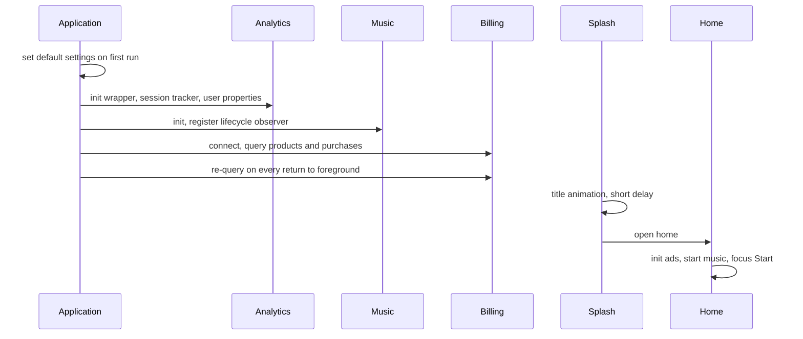
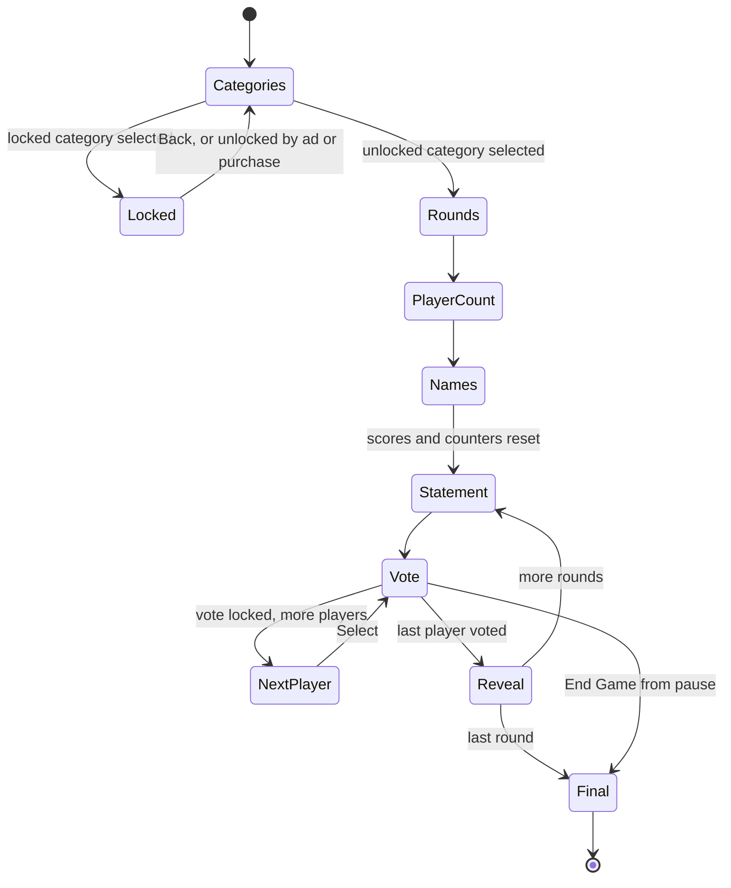
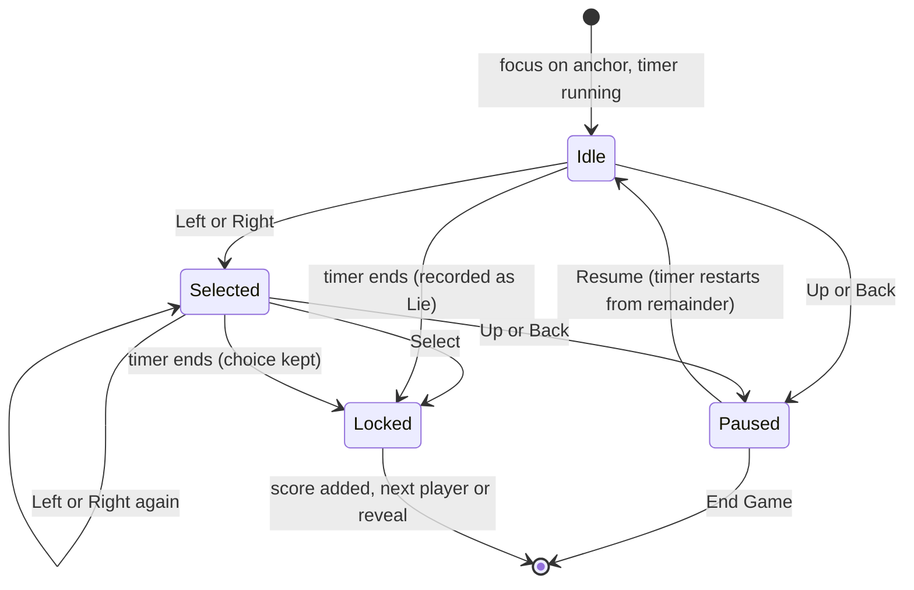
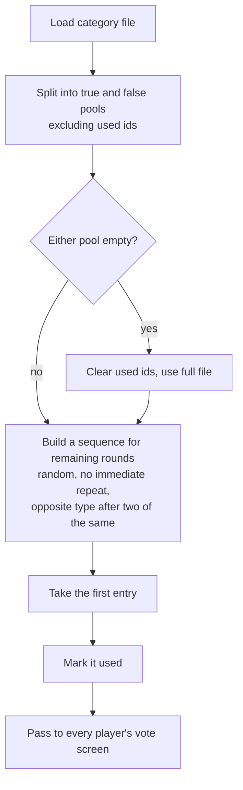

# Architecture

Conceptual view of the Android TV app. Names are descriptive, not production identifiers.

## Layers

| Layer | Responsibility |
|---|---|
| Input | Focus search for menus; an activity-level key handler and a focus anchor on the vote screen; the Back key routed through the back-pressed dispatcher |
| Screens | Splash, home, how to play, settings, purchase, categories, rounds, player count, player names, statement, vote, reveal, final standings, leaderboard (14 activities) |
| Game session | One in-memory object: category, rounds, players with scores, round and turn counters |
| Data | Bundled category files, preferences, a local leaderboard table |
| Services | Music, ads, billing, analytics |
| Native | Kotlin only; no JNI |

## Startup

## A game

## A vote

Input is ignored while a selection animation is running and after the lock.

## Statement selection

## Services

| Service | Notes |
|---|---|
| Music | One `MediaPlayer` at a time, looped; stops when the app is backgrounded; paused around votes and ads |
| Ads | Unity Ads. Interstitial after a game, rewarded ad for a session-long category unlock. Preload, cooldown, entitlement check. Failures fall through |
| Billing | Play Billing client with in-app and subscription queries merged, pending purchases enabled, reconnect after a delay, acknowledgement of unacknowledged purchases |
| Analytics | One wrapper over Firebase Analytics, a pure validator, screen, session, input and ad trackers |

## Data

| Data | Where | Notes |
|---|---|---|
| Statements | App assets, JSON | Read on each statement screen; nothing cached across rounds |
| Settings | Preferences | Timer length, music, track |
| Entitlements | Preferences | Ads removed, all categories unlocked, per-category unlock flag and timestamp |
| Leaderboard | SQLite table | Name, cumulative points, last-played time |
| Game session | Memory | Lost if the process is recreated |

## Design observations

- The activity-per-screen structure with a shared singleton is simple and keeps each screen self-contained, at the cost of state that does not survive process recreation.
- Billing, ads, music and analytics are singletons initialised from the application class or the home screen, which keeps them out of the screens.
- Shared focus feedback is repeated in each screen rather than extracted.
